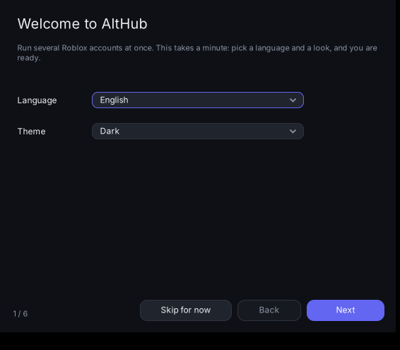
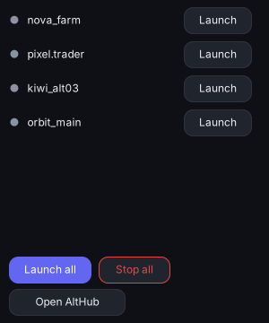
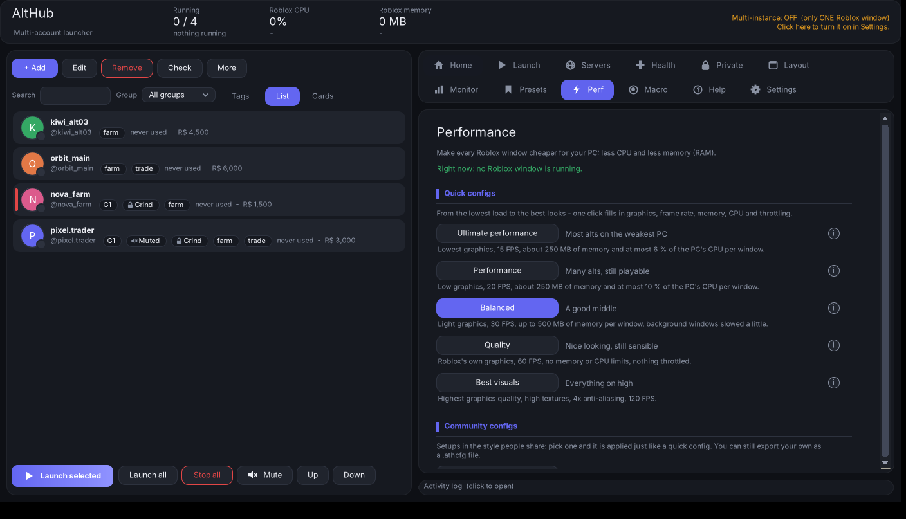
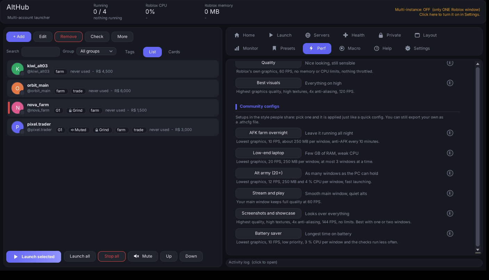
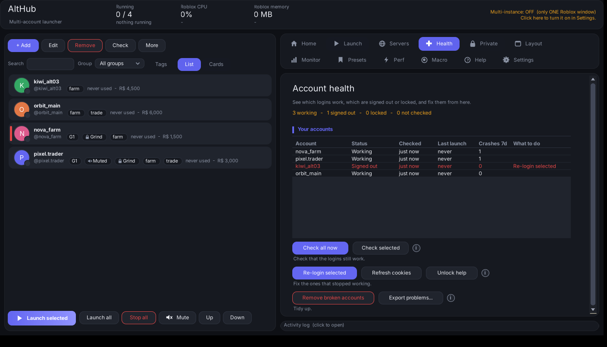
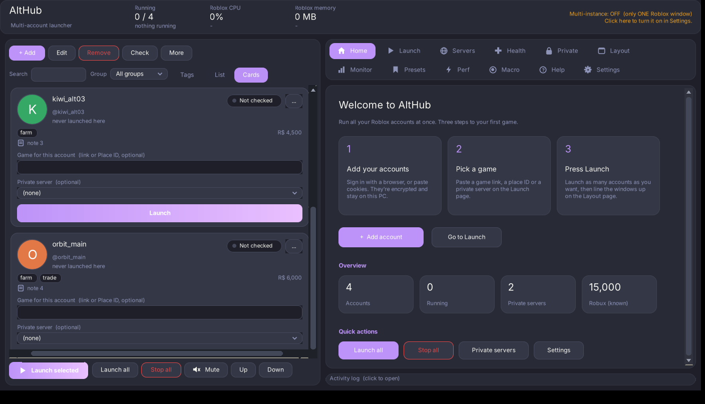
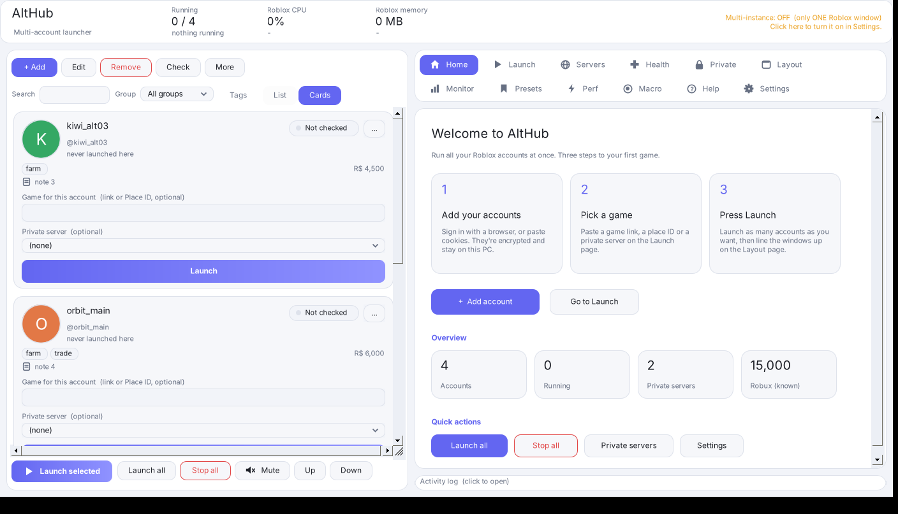
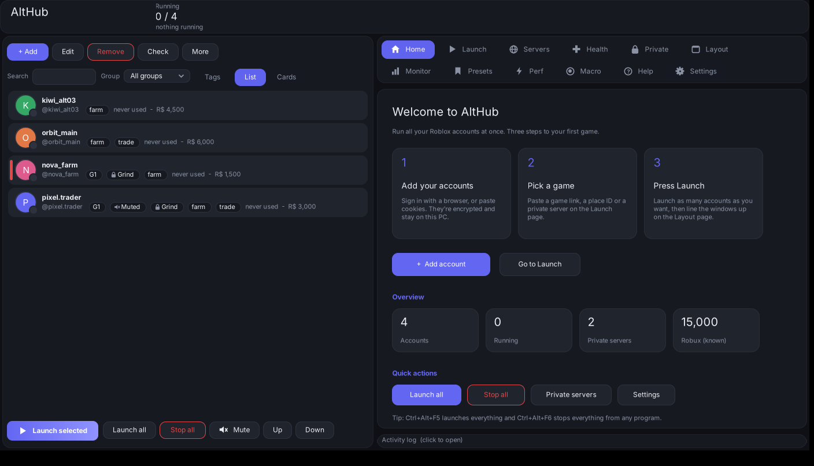

# AltHub

A free Roblox account manager and multi-instance launcher for Windows.

AltHub keeps all your Roblox accounts in one place and starts as many of them as you like at the same time. It lines the windows up on your screen, keeps each window light on CPU and memory, and brings an account back if it crashes or gets kicked. Everything is free, there are no ads, and the full source is in this repository so you can check what it does.

> AltHub is a fork of [Roblox MultiHub](https://github.com/Roblox-MultiHub/Roblox-MultiHub) by the Roblox-MultiHub contributors (GPL-3.0). Most of the app is their work, so please star and support the original. AltHub adds private servers per account, account health, fast launching, configs, themes, languages and more.

  
  

## Contents

- [Getting started](#getting-started)
- [What it can do](#what-it-can-do)
- [Screenshots](#screenshots)
- [Build from source](#build-from-source)
- [Safety and privacy](#safety-and-privacy)
- [Credits and license](#credits-and-license)

## Getting started

1. Download `AltHub.exe` from the [Releases page](https://github.com/s2lq/AltHub/releases/latest) and run it. Nothing needs to be installed.
2. The first-run setup asks for your language and theme, whether to turn multi-instance on, how heavy each Roblox window may be, where to keep your data, and how to add your first account.
3. Add accounts with **+ Add**: log in through a browser, or paste cookies.
4. Pick a game on the **Launch** tab, select accounts on the left and press **Launch selected**.
5. Use the **Layout** tab to arrange the windows.

The **Help** tab inside the app explains every button and option.

The exe is not code-signed yet, so Windows SmartScreen may warn the first time. Programs that automate windows are also sometimes flagged by antivirus software; the source is here if you want to check, and you can add an exclusion.

## What it can do

**Accounts**
- Log in with a browser, paste or import cookies in bulk, or add several with `username:password`
- Groups, tags, colours, notes, aliases, saved passwords and profile pictures
- List view and card view, search, sorting and your own order
- Live status (in game, online, offline) and a Robux balance per account
- Move everything to a new PC as one password-protected `.althub` file

**Launching**
- Join a game, a specific server, a private server, or follow a player
- Fast launch: after the first account the others start a fraction of a second apart and are detected together
- Private servers tab: save named servers, give each account its own, send a whole group into one server, and check that the links still work
- Rejoin the same server after a kick, disconnect or crash, with an auto-relaunch watcher and a crash breaker
- Automatic proxies, one per account or several accounts per proxy
- Roblox version viewer and changer

**Health and monitoring**
- Account health dashboard: which logins work, which are signed out or locked, with one-click recovery
- Event log of crashes, kicks and failed launches per account
- Optional Discord webhook messages and Windows notifications

**Performance**
- Quick configs from Ultimate performance to Best visuals, plus community configs such as AFK farm overnight, Low-end laptop and Alt army
- CPU cap and memory cap per Roblox window, FPS cap, graphics presets, CPU priority and a RAM cleaner
- Mute button for the Roblox sound of selected accounts

**Windows and layout**
- Automatic grid, custom rows and columns, or fixed sizes, across several monitors
- Borderless, always on top, pin a window to an exact spot, live preview

**Look and feel**
- 21 themes, your own colour schemes, and theme import and export
- 10 language packs: Spanish, Portuguese, French, German, Italian, Turkish, Russian, Polish, Indonesian and Dutch
- Compact mode and a small always-on-top mini window
- Tray icon, global hotkeys and keyboard shortcuts

**Sharing and data**
- Shareable `.athcfg` configs that never contain accounts, cookies or private servers
- Portable mode: keep everything in a folder next to the exe, protected by a password
- Presets that restore your accounts, games, layout and settings in one click
- Built-in updater that verifies a SHA-256 checksum before installing
- Anti-AFK and a macro recorder

## Screenshots

  
  

  
  

  
  

  
  

  

The screenshots use made-up accounts.

## Build from source

You need Windows 10 or 11. The C# compiler is already part of Windows, so there is nothing to install.

1. Download this repository (Code, then Download ZIP) or run `git clone https://github.com/s2lq/AltHub`, and extract it.
2. Double-click `START HERE - Build and Run.bat`. It compiles `AltHub.exe` in about 10 seconds and starts it.
3. After you change the source, run `Build.bat` to compile again.
4. Optional: `Install AltHub.bat` installs into your user profile with Desktop and Start menu shortcuts. No admin rights are needed.

If the build prints errors, copy the text from the black window and open an issue. Release builds are made by the [GitHub Actions workflow](.github/workflows/release.yml). Code signing is described in [docs/SIGNING.md](docs/SIGNING.md).

## Safety and privacy

- Accounts are encrypted with your Windows account or with your own password and stay on your PC.
- AltHub only talks to Roblox (and to GitHub if you turn on update checks). Nothing is uploaded anywhere else.
- Nothing is injected into Roblox. Multi-instance works by holding Roblox's single-instance lock.
- Roblox can change its client at any time, and running several clients may be against its rules. You use AltHub at your own risk, with your own accounts.

## Credits and license

AltHub is based on [Roblox MultiHub](https://github.com/Roblox-MultiHub/Roblox-MultiHub) by the Roblox-MultiHub contributors. If you like this, please support the original authors at [buymeacoffee.com/multihub](https://buymeacoffee.com/multihub). The feature set is modelled on Roblox Account Manager and the window layout on OpenMultiBoxing; no code from those projects is used.

Released under the GNU GPL-3.0 license. See [LICENSE](LICENSE). Release notes are in [CHANGELOG.md](CHANGELOG.md).
