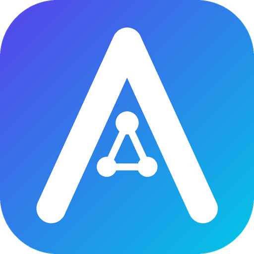
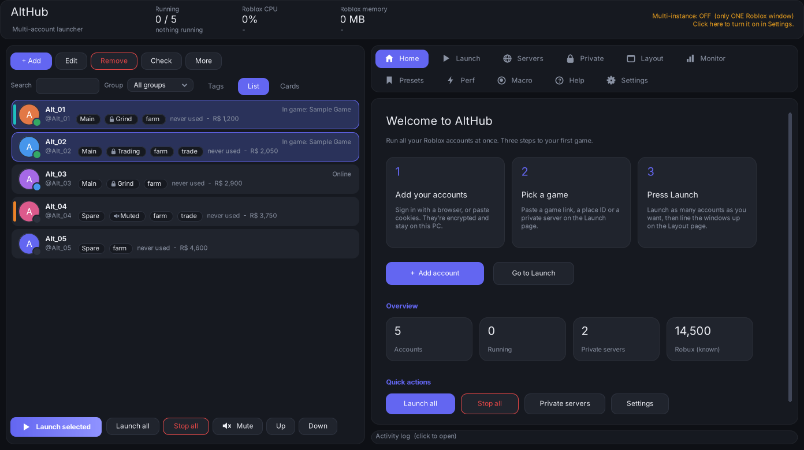
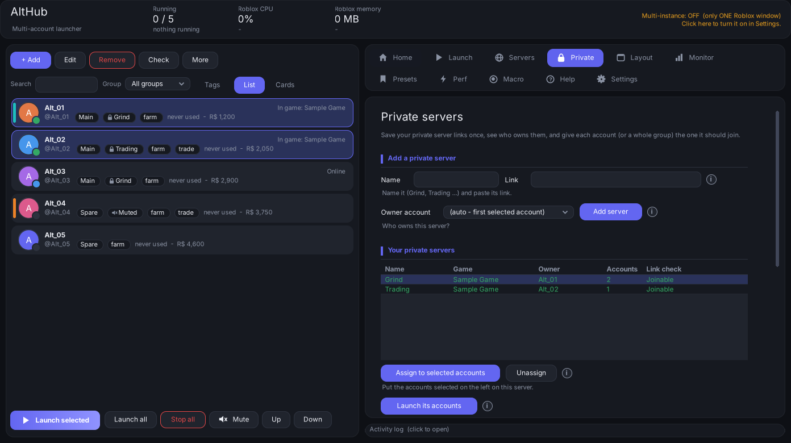
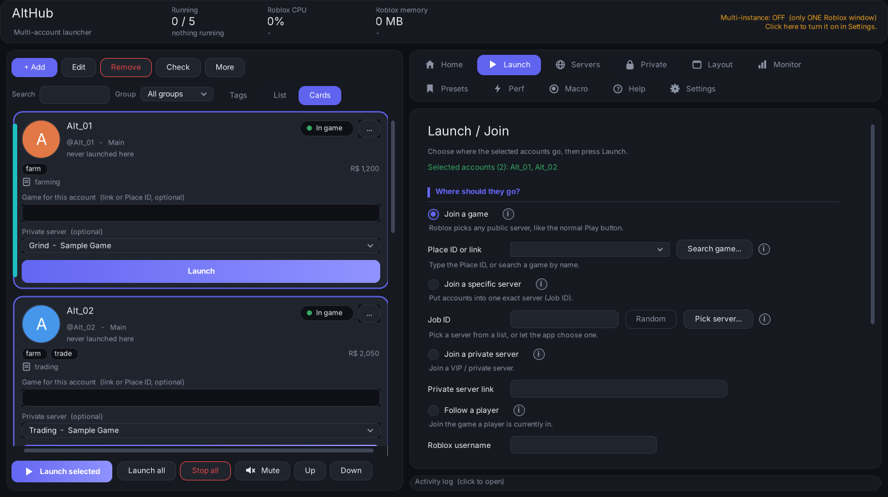
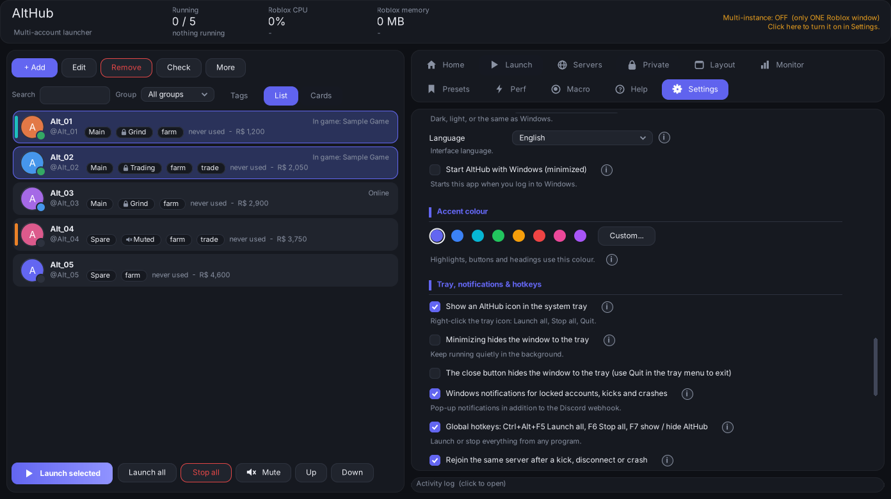
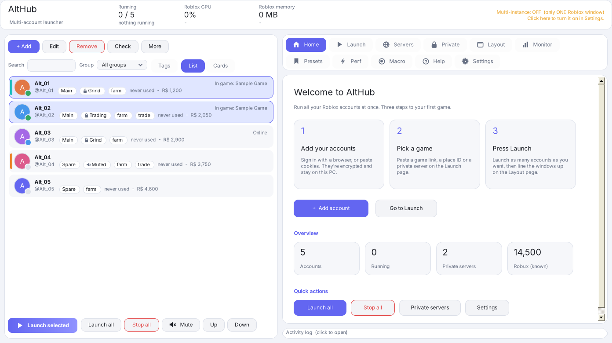

# AltHub

**Run, manage and launch many Roblox accounts at once — multi-instance, window layouts, performance tweaks and more.**

---

> **Credits:** AltHub is a fork of **[Roblox MultiHub](https://github.com/Roblox-MultiHub/Roblox-MultiHub)** by the Roblox-MultiHub contributors, released under the GPL-3.0 license. Nearly all of the app is their work - please support and star the original project. AltHub adds a private server link saved **per account**, a new name and a new icon.

AltHub is a free, all-in-one Roblox account manager and multi-instance launcher for Windows. Add all your accounts once, launch as many as you want at the same time, and arrange their windows neatly over your screen — plus FPS/graphics tweaks, a RAM cleaner, presets, anti-AFK and a built-in macro recorder.

Useful for grinding, trading, holding items on alt accounts, or just keeping all your accounts in one place and launching them with one click.

> It is **100% free** — every feature, no paywalls, no ads. The full source is included, so you can read and check exactly what it does.

## 📸 Screenshots

  
  

  
  

  

Screenshots use made-up sample accounts. Fonts may look slightly different on your PC.

## ✨ Features

**👥 Accounts**
- Log in with a browser, add several with `username:password`, or paste / import / drag-drop cookies (bulk)
- Groups, aliases, notes, saved passwords, profile pictures
- A game per account, search, sorting, your own order
- Edit many accounts at once, view details of many at once (age, Robux, Premium)
- Live status: in game / online / offline
- List view and Cards view
- Startup check: tells you which accounts got signed out

**🚀 Launching**
- Join a game, a specific server (Job ID), a private server, or follow a player
- **Private servers tab** - save named private servers (Grind, Trading ...) with their owner, give each account its own (drop-down on every account card), send a whole group or tag into one server with one click, and check that the links still work
- **Mute button** - mute the Roblox sound of selected accounts, before launch or while running
- **Memory limit per Roblox window** - about 250 MB each (500 MB when a window struggles)
- **Tags, colours, notes and Robux** per account, with bulk actions on a tag
- **Move to a new PC** - export / import accounts and per-account settings as one password-protected `.althub` file
- **Per-account proxy** for the app's web requests
- **Rejoin the same server** after a kick, disconnect or crash
- **Tray icon**, Windows notifications and global Launch all / Stop all hotkeys
- **Follow Windows light / dark** and an accent colour picker
- Search a game by name, pick a server by players / ping / FPS, or random
- Launches like Roblox Account Manager — no "human verification" on join
- Delay between accounts, max-windows limit, auto-close previous window
- Server browser: get many accounts into the **same** server
- Auto-relaunch watcher, Launch all / Stop all

**🪟 Multi-instance & window layout**
- Run many Roblox windows at once
- Automatic grid, custom rows/columns, or fixed size
- Scale, gaps, margins, borderless, always-on-top, multi-monitor
- Pin a window to an exact spot, rename windows to account names
- Live preview, auto-capture, global hotkeys

**⚡ Performance**
- FPS cap + graphics presets (quality, textures, anti-aliasing, grass, sky, API…)
- CPU priority + minimize all
- RAM cleaner (like Mem Reduct): clean now or auto-clean over a limit

**💾 Presets**
- Save your whole setup — accounts, games, window layout, settings
- One click restores everything, or run it automatically at startup

**🛠️ Extras**
- Anti-AFK (stops idle kicks, without interrupting auto-hatch / auto-farm)
- Macro recorder (record & replay mouse + keyboard, like TinyTask)
- Dark / light theme, start with Windows

**🔒 Open & safe**
- Open source — the full source code is included
- Your accounts are encrypted (Windows or your own password) and stored only on **your** PC
- Your data is never uploaded anywhere — the app only talks to Roblox itself
- Automatic backups

## ⬇️ Build & install

You need Windows 10 or 11. Nothing to download or install - the C# compiler is already part of Windows.

1. Download this repository: **Code → Download ZIP** on GitHub, or `git clone https://github.com/s2lq/AltHub`. Extract it somewhere (for example your Desktop).
   *Tip: if Windows shows a "protected your PC" warning, right-click the ZIP → Properties → tick "Unblock" → OK, then extract again.*
2. Double-click **`START HERE - Build and Run.bat`**. It compiles `AltHub.exe` (about 10 seconds) and starts it.
3. Optional: double-click **`Install AltHub.bat`** to install into your user profile (no admin needed) with a Desktop / Start menu shortcut and an *Add or remove programs* entry.
4. After you change the source, run **`Rebuild (only needed after editing the source).bat`**.

If the build prints errors, copy all the text from the black window and open an issue.

Prebuilt `AltHub.exe` files are on the [Releases page](https://github.com/s2lq/AltHub/releases) when available. They are built by the [GitHub Actions workflow](.github/workflows/build.yml) and are **not code-signed**, so Windows SmartScreen may warn.

**My antivirus flagged it?**
It automates windows and input, which some antivirus flags as a false positive. The source is included so you can verify it — add an exclusion if needed.

## 🙏 Credits

AltHub is based on **[Roblox MultiHub](https://github.com/Roblox-MultiHub/Roblox-MultiHub)** by the Roblox-MultiHub contributors (GPL-3.0). If you like this, please support the original authors: [buymeacoffee.com/multihub](https://buymeacoffee.com/multihub). The feature set is modelled on Roblox Account Manager and the window layout on OpenMultiBoxing; no code from those projects is used.

## 📄 License

Released under the **GNU GPL-3.0** license. See [LICENSE](LICENSE).
